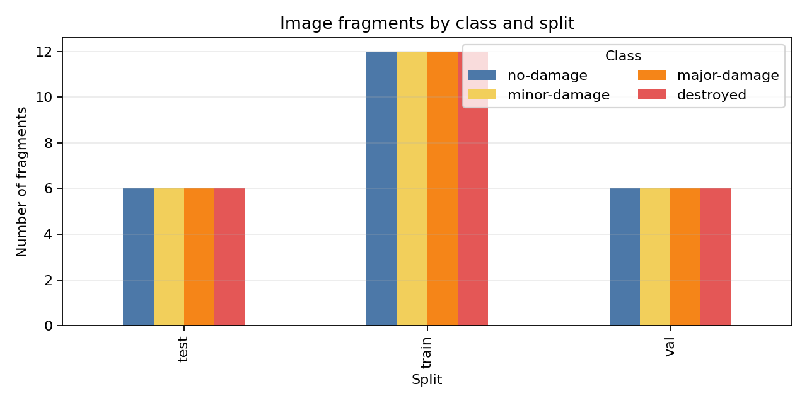

# Лабораторна робота № 2
## Формування та контроль якості датасету — варіант 2

**Дисципліна:** Штучний інтелект для циркулярної економіки  
**Виконавець:** Hleb Bondar  
**Група:** [впишіть групу]  
**Дата:** 05.11.2026

> **Стан звіту.** Виконано два окремі AI-візуальні проходи по 32 прикладах, повторно оцінено 10 прикладів за інструкцією v2.0, сформовано таблицю розбіжностей і обчислено каппу. Це не є подвійною анотацією двох незалежних людей: обидва проходи виконав один AI. Людське анотування, арбітраж і скриншоти інструмента залишаються необхідними, якщо їх вимагає методичка.

## 1. Завдання і джерело даних

За варіантом 2 розглянуто класифікацію стану будівель після руйнування на фрагментах супутникових знімків. Джерело — навчальний архів xBD Challenge `train_images_labels_targets.tar` з офіційними мітками будівель до/після катастроф. Контрольна сума отриманого архіву SHA-1: `b37a4ef4ee9c909e2b19d046e49d42ee3965714b`; вона збігається з опублікованим значенням. Файл має gzip-стиснення попри розширення `.tar`; його структуру прочитано без повного розпакування.

Для цього набору відібрано 96 фрагментів 256×256 px з післяподієвих знімків і чотирьох подій: hurricane-harvey, hurricane-matthew, hurricane-michael, hurricane-florence. Для кожної події взято по 6 об'єктів кожного класу. Мітки запозичено з полігонів xBD, об'єкт розміщено всередині фрагмента з контекстом. Використано знімки з GSD 1,59–3,02 м (середнє 2,36 м); у вибірці є сенсори GEOEYE01 (72), WORLDVIEW02 (16) і WORLDVIEW03_VNIR (8). Дати знімання: 2016-10-01–2018-10-13.

Архівні зображення не розповсюджуються повторно. Перед публікацією похідних даних потрібно дотриматися умов xBD Challenge; за наданою сторінкою завантаження окрема ліцензія на повторне поширення зображень не встановлена.

## 2. Формування маніфесту і підготовка фрагментів

`prepare_xbd.py` потоково читає JSON-мітки, відбирає придатні полігони цільових класів, обирає зразки детерміновано за SHA-256 від ідентифікатора зображення/об'єкта та витягає лише потрібні PNG-фрагменти. Повний архів не розпаковувався. `manifest.csv` містить ідентифікатор, групу-подію, джерело, сенсор, GSD, дату, положення фрагмента у вихідному зображенні, ліцензійне застереження, шлях, мітку xBD і підмножину. `labels/source_annotations.csv` зберігає вихідний ідентифікатор будівлі, полігон, рамку та координати вирізання.

Відібрано 96 зразків (у межах вимоги 80–200); усі зображення доступні й мають розмір 256×256. Фактичні розміри bounding box цільових будівель у вихідних зображеннях: ширина 10,7–123,0 px (медіана 33,0), висота 12,5–101,7 px (медіана 31,1). Відбір виключає об'єкти менші за 10×10 px. Клас і межі об'єкта наведені у вихідній розмітці, але повна ручна перевірка кожного вирізаного фрагмента ще потрібна.

## 3. Таксономія та інструкція з анотації

Використано чотири класи xBD: `no-damage`, `minor-damage`, `major-damage`, `destroyed`. Початкова інструкція збережена у `guideline_v1.md`; уточнення v2.0 у `guideline_v2.md` додає послідовність візуального огляду й правила про дах, частковий обвал, руїни, перекриття та невпевненість, не змінюючи таксономію.

Два AI-проходи оцінювали ті самі 32 зразки за зображеннями без використання джерельного ключа. Файли `annotation-results/annotator_1.csv` і `annotator_2.csv` містять мітки до уточнення (`label_before`) і для відібраних повторних прикладів — після нього (`label_after`). Загалом збіглися 22 із 32 міток; усі 10 розбіжних прикладів вибрано для повторного оцінювання. Список розбіжностей і причини неоднозначності: `annotation-results/disagreements.csv`; окремі повторні форми: `annotator_1_repeat.csv`, `annotator_2_repeat.csv`.

| Порівняння AI-проходів | n | Спостережувана згода | Очікувана згода | Cohen's κ |
|---|---:|---:|---:|---:|
| Початкове анотування | 32 | 0,6875 (22/32) | 0,2646 | 0,5750 |
| Повторне за v2.0 | 10 | 0,7000 (7/10) | 0,3000 | 0,5714 |

Каппу обчислено як `κ=(pₒ−pₑ)/(1−pₑ)`, де `pₑ` — сума добутків маргінальних часток чотирьох класів. Значення незалежно звірено з `sklearn.metrics.cohen_kappa_score`; результати й матриці плутанини збережені у `annotation-results/agreement_summary.csv` та `stats/annotation_confusion_{pre,post}.csv`. Після v2.0 лишилися три розбіжності: `17e47d2bc660`, `ba2c4d846347`, `d23f5f342eda`; мітки обох раундів наведені в `annotation-results/disagreements.csv`. Показник після уточнення не зріс; на n=10 він нестабільний і не дозволяє робити висновок про ефективність інструкції. Це оцінка повторюваності двох проходів одного AI, а не міжекспертна узгодженість людей. Невпевнені приклади залишені з найкращою попередньою класовою міткою та прапорцем `uncertain=1`; вони входять у цей розрахунок. ID та причини зафіксовані окремо в `annotation-results/uncertain_cases.csv` і потребують людського розгляду. IoU/F1 для рамок/масок не застосовуються до класифікаційного завдання.

## 4. Розбиття та перевірка витоків

Щоб відокремити сцени, розбиття виконано групами за подією: train — hurricane-harvey і hurricane-matthew (48 зразків); validation — hurricane-michael (24); test — hurricane-florence (24). Спільних подій між підмножинами немає. У кожній підмножині представлені всі чотири класи. Частки 50/25/25 відрізняються від типових 70/15/15, оскільки для тесту й валідації потрібні окремі незалежні події.

Перевірки скрипта: точних дублікатів SHA-256 — 0; кандидатів dHash з відстанню Геммінга ≤6 — 0; спільних вихідних PNG між підмножинами — 0 (96 унікальних вихідних зображень). Кожен фрагмент вирізаний з окремого вихідного PNG, тому перекриття двох плиток з того самого вихідного зображення відсутнє. Для випадкового поділу частка validation/test зразків, чия подія також присутня у train, становить 1,00/1,00; групове розбиття усуває цей витік (0 спільних подій). Глобальну географічну суміжність і збіг локацій між різними знімками перевірити неможливо без геотрансформацій: використаний Challenge-архів містить PNG/JSON, а не геоприв'язані GeoTIFF. У вибірці використані лише післяподієві кадри, тому часовий витік між парними знімками до/після не виникає; знімки до події не включено.

## 5. Статистика і картка набору

| Підмножина | Зразки | No damage | Minor | Major | Destroyed | Події |
|---|---:|---:|---:|---:|---:|---|
| Train | 48 | 12 | 12 | 12 | 12 | Harvey, Matthew |
| Validation | 24 | 6 | 6 | 6 | 6 | Michael |
| Test | 24 | 6 | 6 | 6 | 6 | Florence |
| **Разом** | **96** | **24** | **24** | **24** | **24** | **4** |

Локальна структура: `images/` — 96 фрагментів; `labels/source_annotations.csv` — вихідні полігони; `labels/double_annotation_queue.csv` — сліпа черга; `annotation-results/` — дві AI-форми, повторні форми, таблиця розбіжностей, список невпевнених випадків і підсумок узгодженості; `manifest.csv` і `split.csv` — опис і поділ; `stats/` — розподіли, матриці плутанини, контрольні суми, кандидати-дублікати й графіки. SHA-256 кожного похідного фрагмента збережено у `stats/checksums.csv`, маніфесту — у `stats/manifest.sha256`. Публічний репозиторій проєкту: https://github.com/glebanty19/lab02-variant2. Через непідтверджені умови повторного поширення xBD у публічному репозиторії розміщені код, звіт, маніфест і розмітка, але не зображення та не сирий архів; зображення можна локально відтворити зі скриптом `prepare_xbd.py`.

Обмеження анотаційного експерименту: 32 зразки замість мінімуму 30 були переглянуті візуально, але обидва проходи зроблені одним AI; вони не є незалежними учасниками й могли мати спільні систематичні помилки. Повторний раунд охоплює саме 10 первинних розбіжностей, тобто відібраний за попереднім результатом, а не випадковий або репрезентативний; його κ не можна напряму порівнювати з оцінкою на всіх 32 чи трактувати як чистий ефект уточнення. Він має малий обсяг і не показав підвищення κ. Зображення низької роздільності, часткове обрізання й перекриття дають невирішені випадки. Людина має незалежно анотувати щонайменше 30 зразків, переглянути неоднозначності, виконати арбітраж за ключем після фіксації міток і додати скриншоти CVAT/Label Studio, якщо цього вимагає завдання. Обмеження набору також включають лише чотири події, штучно збалансовані класи, різні сенсори/GSD і відсутність геоприв'язки; тому результати не підтверджують людську міжекспертну відтворюваність чи узагальнення моделі.

## 6. Використання ШІ та інструментів

ChatGPT/Copilot допоміг написати скрипти підготовки даних і статистики та виконав обидва зазначені візуальні AI-проходи. Це не два незалежні AI-моделі й не люди; отже, погоджені мітки можуть містити спільну помилку. Перший і другий проходи оцінювали зображення без source labels. Після первинного порівняння вибрано 10 розбіжних зразків і обидва проходи повторно переглянули їх за уточненою v2.0. Мітки source xBD для 96 навчальних зразків і мітки AI — окремі дані. Контрольна сума архіву, наявність файлів, розмір зображень, розподіл, поділ за подіями й дублікати перевірені автоматично. Ці дії не замінюють незалежного людського анотування.

## 7. Висновок

Сформовано набір із 96 фрагментів xBD і збережено маніфест, джерельні мітки, групове розбиття та перевірки. Для ручного етапу створені дві форми AI на 32 приклади, уточнена інструкція, повторні форми на 10 розбіжностей, таблиця неоднозначностей і перевірені розрахунки κ=0,5750 до та κ=0,5714 після уточнення. Це максимально виконана AI-частина, але вимога про двох незалежних анотаторів-людей **не виконана**: потрібні ручна незалежна перевірка 30 зразків, арбітраж, перевірка невпевнених випадків і скриншоти інструмента за вимогою викладача.

## 8. Контрольні питання

1. **Джерела даних.** Супутникові платформи дають широке покриття і повторні знімки; БПЛА — сантиметрову деталізацію локальних ділянок; наземні камери — деталі матеріалу, але з перспективою та перекриттями; роботизовані платформи поєднують сенсор і дію, часто в реальному часі.
2. **Роздільна здатність.** Просторова задає розмір пікселя на землі, спектральна — канали/діапазони, часова — період повторного знімання, радіометрична — число рівнів яскравості. Більша деталізація або число каналів може обмежувати покриття й частоту спостережень.
3. **GSD БПЛА.** `GSD = H·p/f`, де H — висота, p — фізичний розмір пікселя матриці, f — фокусна відстань (p та f в однакових одиницях). БПЛА деталізує невелику площу за запитом, але залежить від дозволів, погоди, батарей і геоприв'язки; наземні камери деталізованіші, але мають перспективні спотворення.
4. **Додаткові дані.** Мультиспектральні канали допомагають розрізняти матеріали/рослинність; теплові — виявляти температурні аномалії; висотні — оцінювати форму та об'єм. `NDVI=(NIR−R)/(NIR+R)` оцінює рослинність; `nDSM=DSM−DTM` — висоту об'єктів над землею.
5. **Вибір джерела.** Враховують розмір найменшого об'єкта, потрібну частоту, спектральні ознаки, територію, доступність архіву, хмарність, ціну, ліцензію й наявність розмітки. Для пошкоджень будівель потрібна деталізація, на якій їх можна локалізувати й оцінити.
6. **Таксономія.** Класи мають бути взаємовиключними, повними, корисними для рішення та розрізнюваними за даними. «Інше»/«фон» охоплює зразки поза цільовими класами; у варіанті використовуються чотири класи офіційної легенди, а неоднозначність позначається атрибутом невпевненості.
7. **Типи розмітки.** Класифікаційна мітка описує зображення/фрагмент; bounding box — об'єкт прямокутником; маска/полігон — його попіксельну межу. Формати: CSV/табличні мітки, COCO/YOLO/Pascal VOC для рамок, PNG-маски або GeoJSON/GeoPackage для геоданих.
8. **Шум міток.** Це випадкові або систематичні помилки анотування; він погіршує навчання і спотворює оцінювання, особливо якщо помилки є в тестових мітках.
9. **Узгодженість.** Каппа Коена `κ=(pₒ−pₑ)/(1−pₑ)` коригує спостережувану згоду на випадкову. Для класифікації цього варіанта κ обчислено на спільних прикладах: 0,5750 для початкових 32 AI-оцінок і 0,5714 для повторних 10. Ці значення вимірюють згоду двох проходів того самого AI, а не людей; IoU/F1 доречні для рамок/масок.
10. **Витоки.** Причини: точні/майже дублікати, перекривні чи сусідні плитки, та сама локація в різних датах, глобальна попередня обробка. Групування сценами утримує пов'язані зразки в одній підмножині.
11. **Перцептивний хеш.** dHash кодує локальні різниці яскравості зменшеного зображення; відстань Геммінга виявляє схожі копії. Зсув змінює локальне вирівнювання, тому хеш може пропустити фрагмент; для геоданих його доповнюють перевіркою координат/перекриття.
12. **Документація.** Картка містить мотивацію, склад, збір, анотування, розбиття, обмеження, ліцензію й версію. Відтворюваність забезпечують маніфестом, контрольними сумами, зафіксованими версіями й зерном випадковості.
